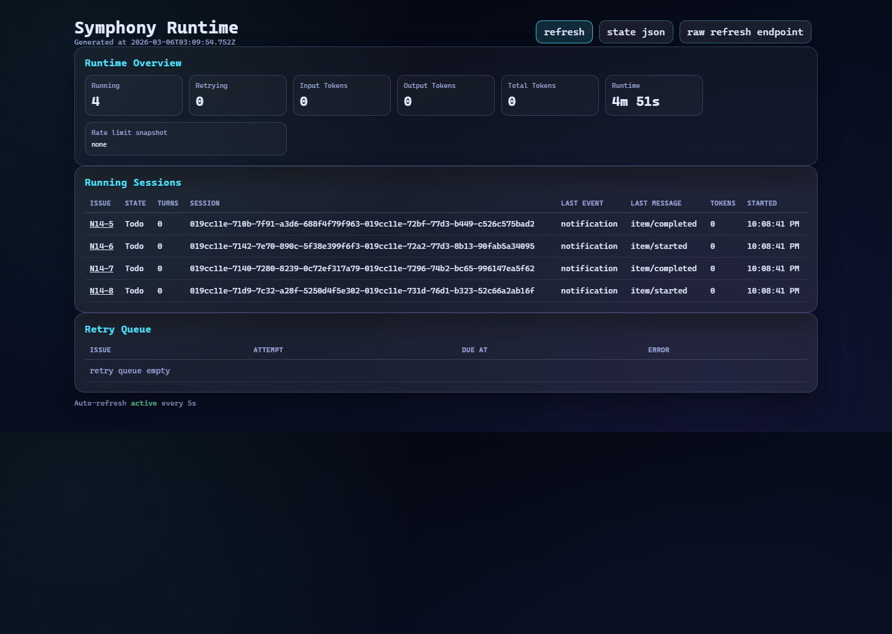

# Symphony

Symphony is a TypeScript workflow service for issue-driven coding-agent work. It reads a repo-owned `WORKFLOW.md`, polls Linear for eligible work, creates per-issue workspaces, launches agent sessions and exposes dashboard plus JSON state endpoints while runs are active.

This repository is a forked implementation effort, not a claim that the Symphony model originated here. Upstream lineage is preserved in `upstream.SPEC.md`, `upstream.README.md` and `upstream.elixir.README.md`.

- **Status:** Active fork
- **Stack:** TypeScript, Node.js, Linear integration, HTTP dashboard
- **Problem:** Long-running coding-agent workflows are hard to trust when state, retries and completion conditions stay hidden behind logs or local process state.

## Why this fork exists

- To make active runs inspectable instead of opaque
- To keep completion gated on explicit verification signals
- To expose operator-readable runtime state through both a dashboard and JSON APIs

## What this repo adds

- Polling orchestration with explicit running, claimed, completed and retry state
- Per-issue workspaces with deterministic naming and lifecycle hooks
- Hot reload for `WORKFLOW.md`
- Dashboard and JSON endpoints at `/api/v1/state`, `/api/v1/:issue` and `/api/v1/refresh`
- Guarded Linear write-back that can require verification evidence before completion
- Session, token and recent-event tracking for active runs

## Architecture at a glance

- `src/service.ts`: wiring for workflow loading, config validation, tracker integration, orchestration and HTTP serving
- `src/orchestrator.ts`: poll-and-dispatch, reconciliation, retries and write-back coordination
- `src/worker.ts`: per-issue agent execution inside the workspace
- `src/http-server.ts`: dashboard and API surfaces
- `WORKFLOW.example.md`: repo contract for tracker, workspace, agent, verification and server behavior

## Run locally

1. Install dependencies with `npm install`.
2. Copy `.env.example` to `.env` or export `LINEAR_API_KEY`.
3. Copy `WORKFLOW.example.md` to `WORKFLOW.md` and fill in your Linear project details.
4. Start the service with `npm run dev -- WORKFLOW.md --port 3000`.
5. Open the dashboard or inspect the JSON APIs.

## Verification

- `npm test`
- `npm run test:conformance`
- `npm run build`

## What to read next

- `docs/landing.md` for the short walkthrough
- `docs/fork-notes.md` for fork framing and authorship notes
- `src/orchestrator.ts` for runtime behavior
- `src/http-server.ts` for operator-facing state
